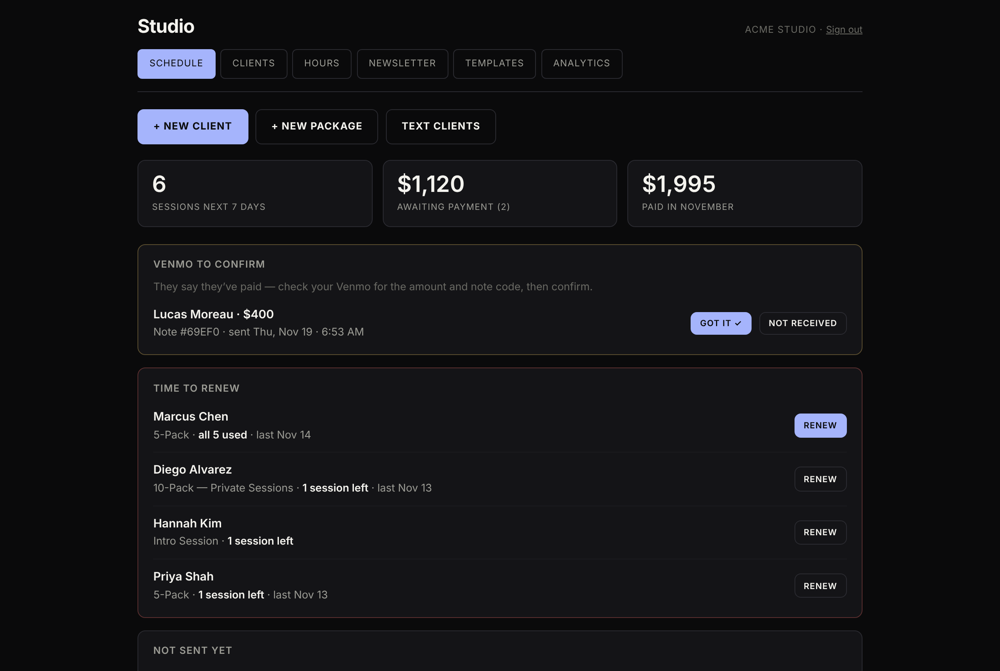
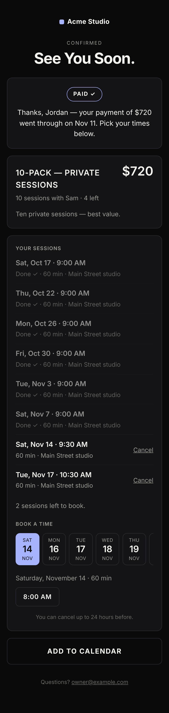
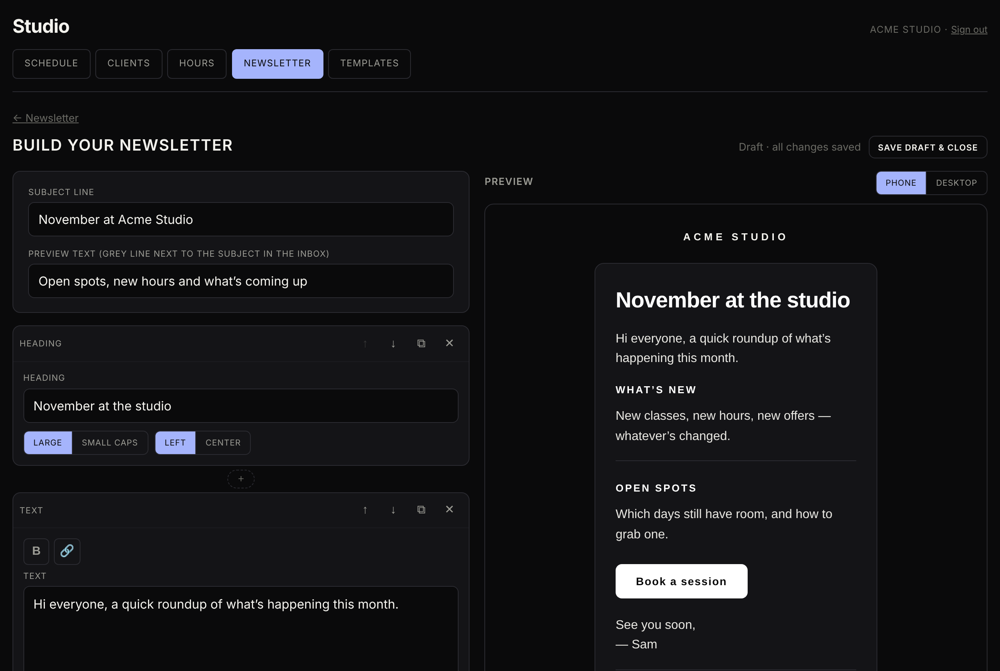
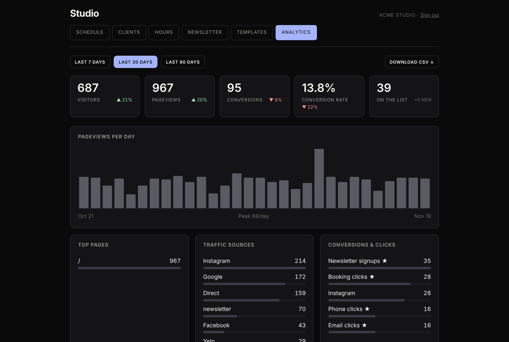

# Client Studio

A self-hosted app for one-person service businesses (coaches, trainers, tutors) to **sell session packages, get paid, let clients book their own times, send newsletters, and see how their website is doing**, all from a phone.

**Next.js 16 · React 19 · TypeScript · SQLite (Node's built-in `node:sqlite`)**. The runtime dependencies are Next, React and Nodemailer.

| Owner's app (`/studio`) | Client's private link (`/pay/…`) |
|---|---|
|  |  |

## What it does

**For the owner (`/studio`, signed in, works well as a home-screen app)**
- **Clients & packages**: each client buys a package (e.g. 5 sessions for $380) at *their own* price. Studio tracks sessions used, flags who's **due to renew**, and renews at their last price in one tap.
- **Send by text or email**: "Text from my phone" opens Messages with the text and private link filled in, so no SMS provider is needed. Email it, or copy the link.
- **Payments**: a Venmo link with the amount and a matching reference code pre-filled. The client taps *I've sent it*, and the owner confirms with *Got it ✓* or *Not received*.
- **Bookable hours**: weekly hours, time off, buffer between sessions, notice period, booking horizon, cancellation window.
- **Calendar feed**: every session, including client bookings, in the owner's phone calendar.
- **Group texts**: pick clients (quick picks: this week, unpaid, due to renew…), write one message with `{first}`, and send each as a private text in one tap per person.
- **Analytics**: cookieless website analytics in its own tab: visitors, pageviews, conversions and conversion rate (each compared with the period before), a daily chart, top pages, traffic sources (Instagram, Google, `?utm_source=`…), clicks, devices and approximate location, over 7, 30 or 90 days, with a CSV export. Track the business's real site with one script tag (see below).
- **Newsletter builder**: heading, text, image, button, divider, spacer and social blocks with a live phone/desktop preview, autosaving drafts, test sends, a batched send queue, and CAN-SPAM-compliant unsubscribe (including RFC 8058 one-click).

**For the client (`/pay/<token>`, no account needed)**
- See their package, pay, and **book or cancel times** from the owner's real availability.
- Add sessions to their calendar and get email confirmations.





## Try it locally

Requires Node 22.18+.

```bash
npm install
npm run setup -- --demo   # writes .env.local; login is demo / demo
npm run seed              # fake clients, packages, sessions, subscribers
npm run dev
```

Open <http://localhost:3000/studio>. A client's view is linked from any package ("Copy link"). Without `SMTP_URL`, emails are written to `data/outbox.log` instead of being sent.

For a real install run `npm run setup` without `--demo`. Every setting is in [`.env.example`](.env.example).

## Website analytics

The demo home page already has the tracker. For the business's real website, add one line:

```html
<script src="https://your-studio-host/track.js" defer></script>
```

It records a pageview per page plus clicks: `mailto:` and `tel:` links, social and outbound links, and anything tagged `data-track="name"` (links, buttons, or a `<form>` on submit). `window.track('name')` works from your own code. The event names in `CONVERSION_EVENTS` (default `signup,book,contact,email,phone`) count as conversions.

How privacy works:
- **No cookies or storage.** A visitor ID is an HMAC of IP + user agent + **today's date**, keyed with `APP_SECRET`. It can't be reversed or follow anyone across days.
- **No raw IPs are stored and no outside lookups are made.** Location comes from the host's geo headers (Vercel, Cloudflare) when present.
- **Clients' private links are never recorded.** The tracker isn't on `/pay/…` pages, and ingestion strips the token from any `/pay/…` path or referrer that arrives anyway. The owner's own Studio screens are never counted either.
- Bots are filtered, ingestion is rate-limited per address, and hits older than ~13 months are pruned.

## How it's built

```
app/
  studio/            the owner's app: Server Components + Server Actions per area
    packages/        new/renew/edit form, detail page, actions
    clients/ hours/ templates/ texts/ newsletter/ analytics/
    feed.ics/        private calendar feed
  pay/[token]/       client page, booking actions, .ics download
  unsubscribe/ api/unsubscribe/   unsubscribe page + one-click endpoint
  api/track/ track.js/   analytics ingestion + the drop-in tracker script
  page.tsx           demo home page with the newsletter signup and tracker
lib/
  booking.ts         rules, availability, booking/cancel, payment state, messages
  newsletter-render.ts  block model + email HTML/text (shared by server and the live preview)
  newsletter.ts      mailing list, unsubscribe signing, send queue
  studio.ts          read models for the Studio screens
  analytics.ts tracking.ts tracker.ts   Analytics queries, beacon → row, the browser tracker
  db.ts auth.ts session.ts email.ts ics.ts format.ts form.ts
scripts/             setup + demo seed (run directly by Node)
tests/               node:test, ported from the original PHP suite
```

Engineering notes:
- **Concurrency-safe booking.** A booking is re-validated inside a `BEGIN IMMEDIATE` transaction, so two clients can't take the same slot. Cancellation re-checks its window inside the `UPDATE` itself.
- **Availability** (`slots()`) intersects weekly hours with time off, buffered existing sessions and the notice period, building every time from the local wall clock so DST days are correct. Tests cover the spring-forward day.
- **One renderer for the email and its preview.** `newsletter-render.ts` has no server imports, so the builder's live preview runs exactly the code that sends.
- **Security**: scrypt password, HMAC-signed session cookie (a password change signs out everywhere), a login throttle counted before verification, auth re-checked inside every Server Action, block content whitelisted and escaped, HMAC-signed unsubscribe links, formula-safe CSV export, and a constant-time check on the calendar feed key.

## Design decisions

This started as a PHP app. Moving to TypeScript was also a chance to remove things that cost more than they gave:

| Removed | Why |
|---|---|
| Twilio auto-texting | Needs carrier registration and fees; "Text from my phone" covers it. |
| Several phone numbers per client, group-thread texting | Platform-specific SMS link formats for a rare case. Group texts are one private text per person. |
| Importing packages bought before the app | A one-time migration concern that touched every usage query. |
| Calendar *import* (custom iCal/recurrence parser) | ~300 lines of parsing for a niche feature. The export feed stays. |
| Newsletter image upload + re-encoding | Image blocks take a URL; hosting images is a solved problem elsewhere. |
| Hourly email cap tuned for one host, cron sender | Batches are sent from the open page; the email provider sets the limits. |
| Hand-rolled CSRF tokens, session files, signed form nonces | Server Actions check the origin; sessions are signed cookies; signup uses a honeypot and rate limit. |

## Scripts

| | |
|---|---|
| `npm run dev` / `build` / `start` | Next.js |
| `npm test` | unit tests (`node --test`) |
| `npm run typecheck` | `tsc --noEmit` |
| `npm run setup` | create or update `.env.local` (also changes the password) |
| `npm run seed` | demo data (`-- --reset` to replace) |

## Deploying

It needs a Node host with a persistent disk for the SQLite file (Render, Fly.io, Railway, a VPS). Set the variables from `.env.example`, including `SMTP_URL` for real email, run `npm run build && npm start` behind the platform's proxy, and back up `data/`.
